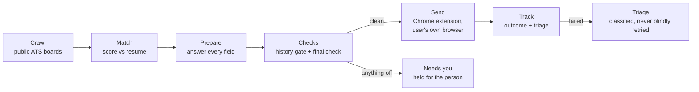

# Understudy

**A fully autonomous job applier.** Understudy crawls public company job boards, matches new postings to your resume, answers every question on the application form, and submits it from your own browser. Then it tracks what happened.

Live: **[understudy.live](https://understudy.live)** · 140 users · 7,000+ applications sent · about $0.005 of model cost per application

> This repo is a public overview of the architecture plus a few excerpts from the source. The product's full source is private: it holds the drivers for each employer's application site and user-facing operational code.

## How it works

| Stage | What it does |
| --- | --- |
| **Crawl** | One adapter per applicant tracking system (Greenhouse, Lever, Ashby, Workable, SmartRecruiters, Recruitee, Workday, Rippling, plus large employers' own career sites). Each adapter turns a board into a list of postings and a posting into a normalized form schema (`src/ats/types.ts`). It runs on two cron lanes: everything hourly and hot boards every 15 minutes. An unchanged board is detected by hash and writes nothing. |
| **Match** | Scores each fresh posting against the person's resume and preferences (role, level, location, sponsorship). Autopilot only takes matches above a threshold, and per-employer pacing keeps it from flooding one company. |
| **Prepare** | Fills the form in layers. Standard fields (name, email, links, location) come straight from the profile. EEO and self-ID questions come only from the person's own settings, never from a model. Education rows are matched by rule to the board's own catalogue. A model answers only the open-ended questions, and a final deterministic guard has the last word on work authorization, sponsorship, age and relocation. |
| **Checks** | The *history gate* compares every work and education row the application would type against the text of the resume the person actually uploaded, and holds any difference for them to review. Parsers make mistakes, and this catches them before an employer sees them. |
| **Send** | A Chrome extension fills and submits the form in a pinned background tab of the person's own browser, using their own sessions. Decisions like which option to pick in a dropdown or which job a row refers to live in one shared module that the server runs as well, so a matching fix ships without an extension release. |
| **Track** | Every send reports an outcome. Failures are triaged into causes (posting closed, needs a human, account step, driver bug) and shown on a failures page, never requeued blindly. |

## Stack

- **Web:** Next.js 16 (App Router), React 19, TypeScript, Tailwind, deployed on Vercel
- **Data:** Postgres (Neon). Applications, jobs, answers and usage are all rows; schema migrations are plain SQL.
- **Models:** an open-weight model (GLM) via OpenRouter, with per-call cost tracking in a daily usage table and per-account spend caps
- **Extension:** Chrome MV3, one step driver per application site
- **Ops:** cron crawl lanes, rate limiting on every expensive route, and an automated bug hunter on each push (forms hypotheses from the diff, proves them by running code, files reproduced bugs as issues)

## Design decisions worth calling out

- **Models only where judgment is needed.** Anything with a correct answer (identity, EEO, authorization, education catalogue picks) is decided by rules. That keeps cost per application around half a cent and makes the risky answers auditable.
- **Your resume is the source of truth, not the parsed profile.** The history gate exists because every earlier check compared the form to the *parsed* resume, and the parser was the thing that went wrong.
- **Send from the user's browser.** Applications go out from the person's own sessions and IP, never from a shared cloud browser.
- **Failures are data.** Every failed send is classified, and the fix goes into the adapter or driver, not a retry loop.

## Source excerpts

- [`src/ats/types.ts`](src/ats/types.ts): the adapter contract and normalized form schema every board is converted into
- [`src/ats/greenhouse.ts`](src/ats/greenhouse.ts): the Greenhouse adapter, including reading the Education block the public API doesn't expose
- [`src/ats/util.ts`](src/ats/util.ts): fetch helpers, HTML-to-text, and standard-field detection from labels

These files are excerpts and won't build on their own.

Built by [Keugene Lee](https://keugenelee.com).
